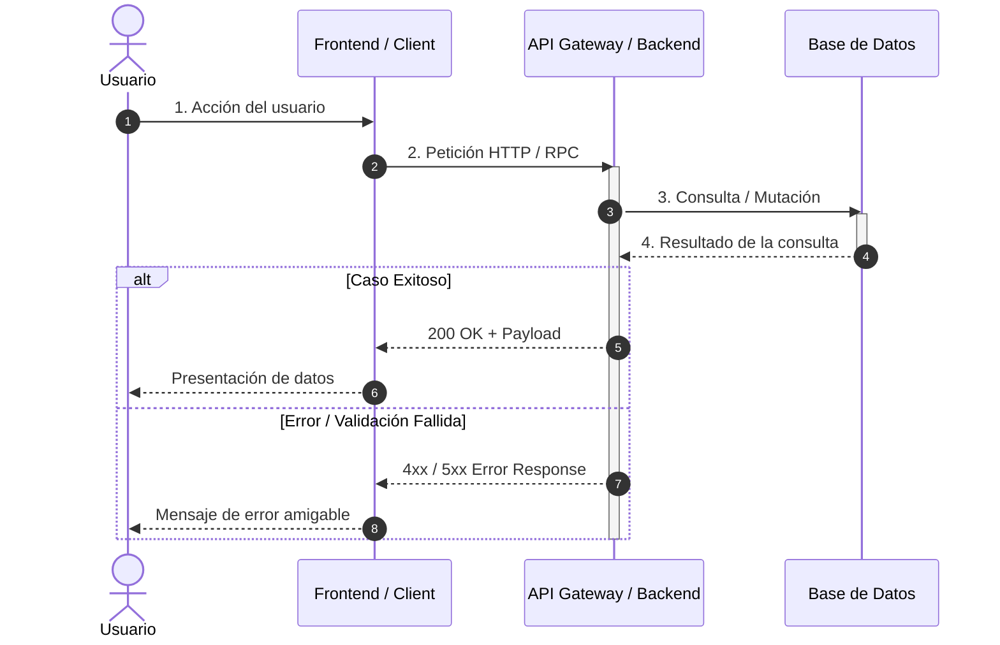

# Sequence Diagrams (UML 2.5 & Mermaid)

Este skill define el procedimiento estándar para diseñar, validar y documentar diagramas de secuencia UML utilizando la sintaxis de Mermaid en proyectos de software y arquitectura.

---

## 1. Principios Fundamentales (UML 2.5)

Un diagrama de secuencia modela el **comportamiento dinámico** mostrando cómo interactúan los objetos en un orden temporal (de arriba hacia abajo).

### Elementos Clave
1. **Líneas de Vida (*Lifelines*)**: Representan instancias, servicios o actores a lo largo del tiempo.
2. **Mensajes**:
   - **Síncronos (`->>`)**: Solicitudes bloqueantes que esperan respuesta.
   - **Asíncronos (`-)`)**: Mensajes de disparo y olvido (*fire-and-forget* / eventos).
   - **Retornos (`-->>`)**: Respuestas explícitas a mensajes síncronos.
3. **Barras de Activación**: Delimitan el periodo en el que un componente tiene el control de ejecución (`activate` / `deactivate`).
4. **Fragmentos Combinados (*Combined Fragments*)**:
   - `alt / else`: Condiciones mutuamente excluyentes (if/else).
   - `opt`: Flujo condicional opcional (if sin else).
   - `loop`: Reiteración o bucle.
   - `par`: Ejecución concurrente o en paralelo.
   - `critical`: Sección crítica no interrumpible.

---

## 2. Guía de Sintaxis en Mermaid

Para representar diagramas de secuencia en Markdown, utiliza siempre el bloque ` ```mermaid `:



### Tabla de Notación de Mensajes en Mermaid

| Tipo de Mensaje | Sintaxis Mermaid | Significado UML |
| :--- | :--- | :--- |
| **Síncrono (llamada)** | `A->>B: llamada()` | Flecha sólida con punta llena. Emisor espera respuesta. |
| **Retorno** | `B-->>A: respuesta` | Flecha punteada con punta abierta. Retorno de valor. |
| **Asíncrono (evento/cola)** | `A-)B: evento` | Flecha sólida con punta abierta. No bloqueante. |
| **Pérdida de mensaje** | `A-xB: mensaje` | Mensaje fallido o descartado en red. |
| **Nota explicativa** | `Note over A,B: Texto` o `Note right of A: Texto` | Anotación contextual sobre participantes. |

---

## 3. Flujo Paso a Paso para Generar un Diagrama de Secuencia

Cuando el usuario pida documentar un flujo, caso de uso o API:

1. **Definir el Alcance del Escenario**:
   - Determinar si es un **Diagrama de Secuencia del Sistema (SSD)** (caja negra: Actor $\leftrightarrow$ Sistema) o un **Diagrama de Secuencia Interno** (componentes/microservicios/clases).
2. **Identificar Participantes**:
   - Listar actores humanos (`actor`) y componentes de software (`participant`).
   - Usar alias cortos y legibles (`participant A as AuthService`).
3. **Establecer la Cronología**:
   - Ordenar las llamadas desde el evento disparador inicial.
   - Usar `autonumber` para facilitar la referencia a pasos individuales.
4. **Gestionar la Activación**:
   - Activar (`activate`) al recibir llamadas síncronas y desactivar (`deactivate`) al devolver la respuesta.
5. **Manejar Casos de Error y Bifurcaciones**:
   - No limitar el diagrama al "camino feliz" (*happy path*).
   - Incluir bloques `alt / else` para errores de autenticación, validación o timeouts.

---

## 4. Reglas de Calidad y Buenas Prácticas

- **No sobrecargar un solo diagrama**: Si una interacción tiene más de 15-20 mensajes, dividirla en subdiagramas o usar referencias.
- **Consistencia temporal**: El orden de las líneas en el código Mermaid define el orden en el tiempo. Nunca cruzar mensajes de manera ilógica.
- **Claridad en los nombres de mensajes**: Usar verbos claros o firmas de métodos reales (ej. `POST /api/v1/checkout`, `validateToken(jwt)`).
- **Siempre validar la renderización**: Asegurar que las etiquetas y textos no contengan caracteres conflictivos con Mermaid sin comillas o escape.
