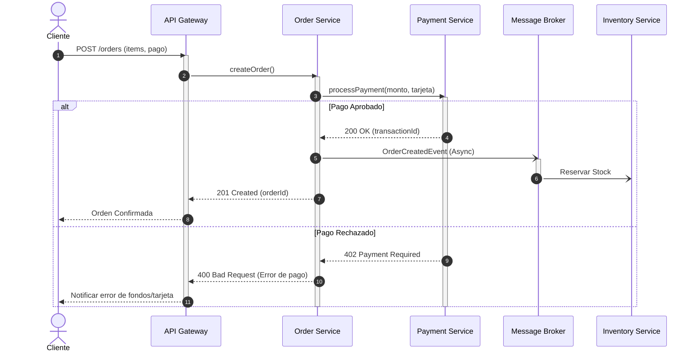

# Ejemplo: Flujo de Procesamiento de Órdenes (Microservicios)

Este ejemplo muestra la interacción entre servicios desacoplados utilizando llamadas síncronas (REST/gRPC), eventos asíncronos (Event Bus / Kafka) y fragmentos combinados (`alt`, `opt`).

